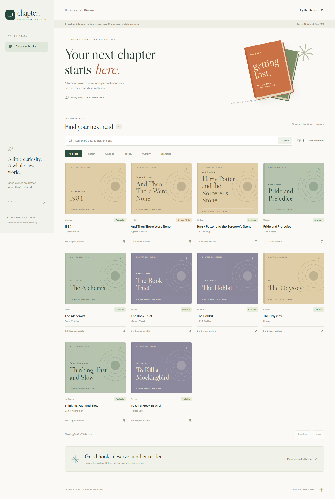

# Chapter · The community library

A Java + React library application: find a book, reserve a copy, manage lending, and keep the collection moving. Refined from an object-oriented programming assignment into a tested, database-backed portfolio project.

**Publishing status:** deployment is prepared; public hosting is deferred at the owner's request.



## Try it locally

Prerequisite: Docker Desktop with its Linux engine running.

```sh
docker compose up --build -d --wait
```

Open [Chapter at localhost:8080](http://localhost:8080), choose **Try the library**, and enter as a reader, librarian, or administrator. The first build downloads dependencies; later builds use cached layers.

`docker compose stop` and `docker compose start` preserve the database volume. In demo mode, the library deliberately resets daily at **04:00 Asia/Kuala_Lumpur**, including a catch-up reset after downtime. All visitors share sample accounts and records. Use fictional information only.

## Features

| Role | Experience |
| --- | --- |
| Visitor | Search titles, authors, and ISBNs; filter by genre and availability |
| Member | Reserve, cancel, inspect loans/history, renew eligible loans |
| Librarian | Issue/return copies, inspect members, monitor overdue loans and pickups |
| Administrator | All circulation features plus title, author, copy, and account management |

- Five active loans, 14 days each; one additional 14-day renewal if eligible.
- First-come reservations among eligible members, with 72-hour pickup holds.
- RM0.50 per overdue day; illustrative fines, no payment processing.
- Archived records preserve history; active loans/holds block unsafe archiving.
- Password hashing, server sessions, CSRF protection, role/ownership checks, protected demo accounts.

## Development

Use **Java 21**, **Node 22.16+**, and Docker. Maven is provided through the wrapper.

```sh
docker compose up -d db
./mvnw spring-boot:run
```

In another terminal:

```sh
cd frontend
npm ci
npm run dev
```

Open [the development frontend](http://127.0.0.1:5173). Vite proxies API calls to Java on port 8080. On PowerShell, use `./mvnw.cmd` and `npm.cmd` if script policy blocks commands. Stop the Compose `app` service before starting another Java process on port 8080.

`.env.example` documents configuration. Compose reads `.env`; a directly launched Java process needs actual environment variables or Spring command-line properties. Defaults are only for local sample data.

## Verify

```sh
./mvnw verify                         # unit + PostgreSQL integration tests; Docker required
cd frontend
npm ci
npm test
npm run build
npx playwright install chromium
npm run test:e2e                      # local app running on port 8080
```

Integration tests use disposable PostgreSQL containers. Browser tests mutate the shared demo and expect a fresh local dataset; do not run them against a public installation with active visitors. [Verification details](docs/verification.md).

## Structure

```text
src/main/java/com/portfolio/library/   Domain, services, security, API
src/main/resources/db/migration/      Versioned PostgreSQL schema
src/test/java/com/portfolio/library/  Unit and database/API tests
frontend/src/                        React pages, API client, CSS Modules
frontend/e2e/                        Browser workflows
.github/workflows/ci.yml              Automated build and tests
Dockerfile                           React + Java production image
compose.yaml                         Local app and persistent PostgreSQL
render.yaml                          Free Render deployment configuration
docs/                                Design, API, deployment, portfolio materials
```

Java 21 · Spring Boot · Spring Security · Spring Data JPA · PostgreSQL 17 · Flyway · React · TypeScript · Vite · React Router · JUnit · Testcontainers · Vitest · Playwright.

## Portfolio materials

- [Architecture and database diagram](docs/architecture.md)
- [API reference](docs/api.md)
- [Deployment and operator guide](docs/deployment.md)
- [Assignment-to-portfolio case study](docs/case-study.md)
- [Verification record](docs/verification.md)
- [Demo recording](docs/media/chapter-demo.webm)

The original assignment is preserved at tag **`assignment-original`**. Inspect it with `git show assignment-original:README.md`; no working-tree reset is needed. Only the new web interface is maintained.

This is a bounded shared demo, not a production library service. Deliberate limits include serialized operations, small capped datasets, in-memory sessions, and daily resets. Free hosting can sleep. No public registration, real personal data, email, payments, or external book integrations are included.
