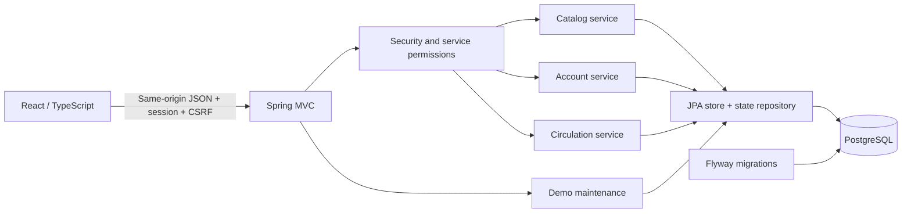
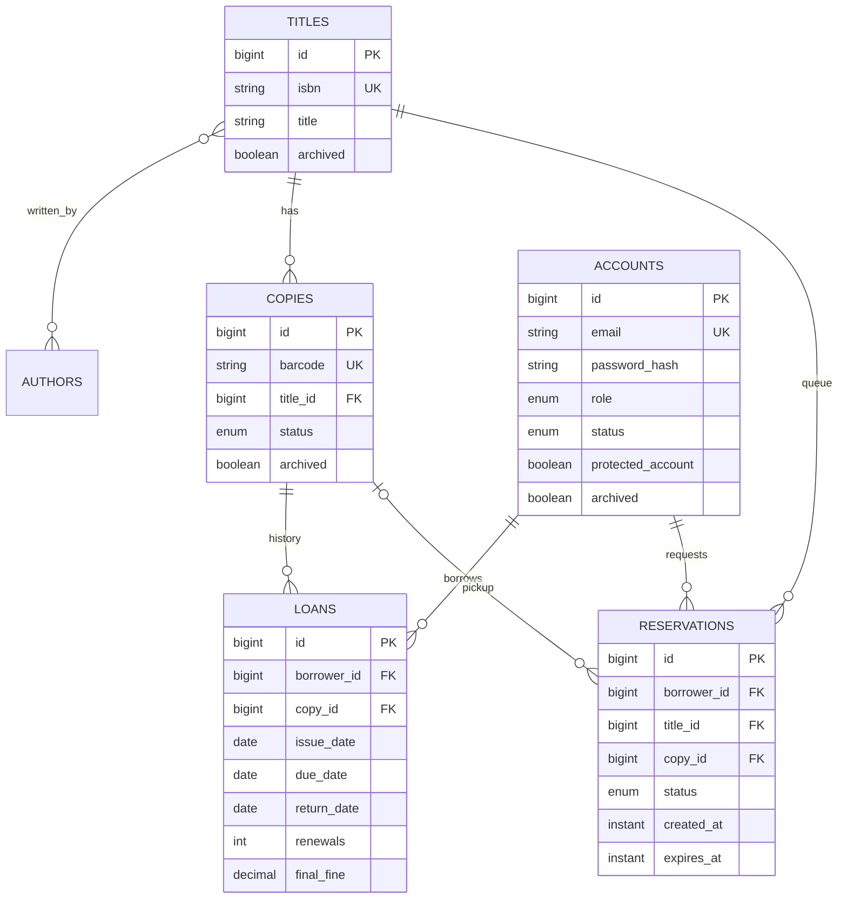
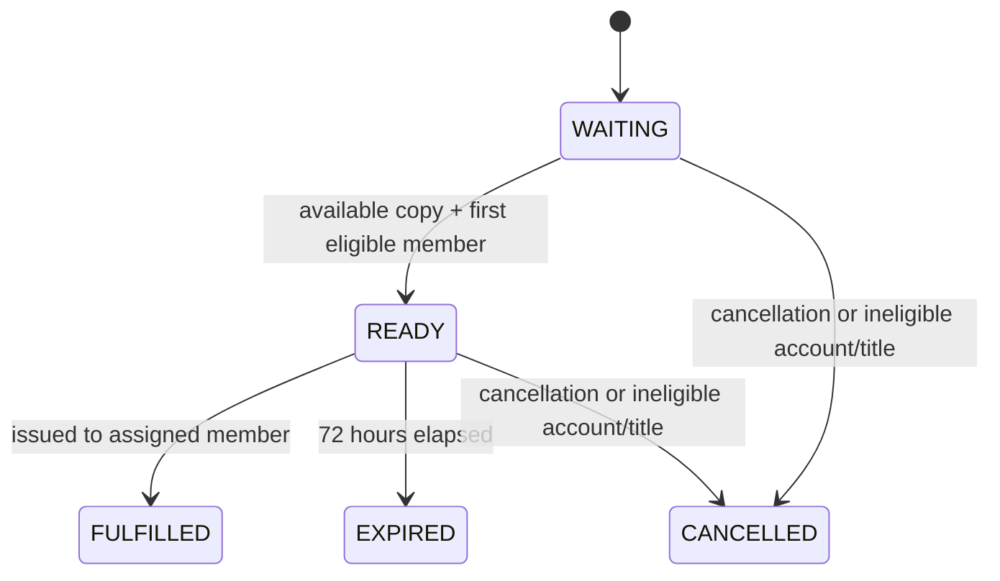

# Architecture and data model

Docker bundles Vite output into the Spring Boot JAR. Static content and `/api/v1` share one origin. Vite proxies API calls during development. Explicit request/response records keep persistence models out of HTTP payloads.

Additional tables hold the title-author join, demo generation/reset state, and recent activity. Database identity columns generate IDs. Partial unique indexes enforce one active loan/hold per copy and one active reservation per member/title.

## Consistency

Service operations acquire a pessimistic lock on a singleton library-state row within a transaction. This serializes this small demo's operations, including reads, allocation, and reset. Competing requests cannot take the same copy, bypass the fifth-loan limit, or observe a partial reset. Database constraints provide a second line of defense.

The design intentionally favors straightforward correctness over throughput. Main entities are capped at 1,000 records each; activity is capped at 500. Some catalog filtering happens in memory. A larger production system should move filtering/pagination into SQL and replace the global lock with carefully ordered finer-grained locks.

Members at the loan limit stay queued but are skipped until eligible. Queue position is waiting order, not a guaranteed pickup time. Issuing rechecks status and borrowing limits. An active reservation by another member prevents renewal. Returned loans are retained, and final fines stop changing.

## Time and authentication

Calendar dates use `Asia/Kuala_Lumpur`; event timestamps use `Instant`. An injected clock makes boundary tests deterministic. Fines use decimal arithmetic.

Server sessions contain account ID and demo generation. Protected service calls recheck generation, current role, and account status. BCrypt hashes passwords. Login rotates session ID and CSRF token; the browser fetches a token before every write. Restart loses in-memory sessions but retains the database.

Reset runs at 04:00 Malaysia time, with a persisted catch-up check on startup and API requests. It atomically reseeds under the same database lock and increments the generation. Old sessions then fail protected calls. No public reset endpoint exists.

Quick entry is intentionally restricted to the demo configuration and grants sample roles in a shared sandbox. Seeded accounts cannot be changed or archived. It must never protect real private information.
